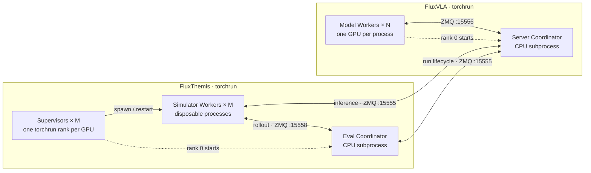

# FluxThemis

FluxThemis runs simulation and real-environment evaluation for FluxVLA. The
model boundary is a versioned ZMQ protocol: FluxThemis owns environments and
episode scheduling, while FluxVLA owns model loading, preprocessing, inference,
action denormalization, and authoritative benchmark artifacts.

## Responsibilities

| Component  | Owns                                                                                                                        |
| ---------- | --------------------------------------------------------------------------------------------------------------------------- |
| FluxVLA    | Config, checkpoint, model replicas, dataset pipeline, statistics, action units, evaluation journal, final benchmark summary |
| FluxThemis | Environment processes, task discovery, episode scheduling, environment cases, action execution, videos                      |

The model service is stateless. Every prediction request contains the complete
observation and prompt, so consecutive requests from one episode may run on
different model workers.

## Installation

For development, install only the core package and ZMQ runtime:

```bash
conda create -n fluxthemis-dev python=3.10 -y
conda activate fluxthemis-dev
cd /root/projects/FluxThemis
python -m pip install -e .
```

Evaluation workers run in simulator-specific environments. Choose one
benchmark environment; do not install all simulator stacks together.

For LIBERO:

```bash
cd /root/projects/FluxThemis
conda create -n fluxthemis-libero python=3.10 -y
bash scripts/install_libero.sh
```

For RoboCasa:

```bash
cd /root/projects/FluxThemis
conda create -n fluxthemis-robocasa python=3.10 -y
bash scripts/install_robocasa.sh
```

For RoboDojo:

```bash
cd /root/projects/FluxThemis
bash scripts/install_robodojo.sh
```

Each simulator installer installs the FluxThemis package into its target
environment. A separate core environment is not required for evaluation.

FluxVLA and FluxThemis may use different Python environments. They only need a
reachable TCP endpoint and the same configuration semantics.

Activate each repository's Conda environment before running its launcher. The
launchers resolve `torchrun` and Python from the active environment; they do not
activate or switch environments themselves.

## Configuration

Evaluation settings live in the target FluxVLA config:

```python
themis = dict(
    transport=dict(
        image_keys=['cam_high', 'cam_left_wrist', 'cam_right_wrist'],
        state_keys=['states'],
        unnorm_key='robodojo_arx_x5',
    ),
    evaluation=dict(
        environment=dict(type='RoboDojoEnvironment', task_name='all'),
        policy_client=dict(type='FluxVLAPolicyClient'),
        reporter=dict(type='FluxVLAEvaluationReporter'),
        evaluator=dict(type='SuccessRateEvaluator'),
        base_seed=0,
        episodes_per_task=50,
        max_episode_steps=2000,
        execute_horizon=50,
    ),
    server=dict(
        evaluation_reporting=dict(enabled=True),
        denormalize_context=dict(task_suite_name='robodojo_arx_x5'),
    ),
)
```

`themis.transport` is injected into the policy client and reporter at runtime;
do not duplicate it inside either component mapping.

An `EvaluationRun` owns its validated `EvaluationSettings`, mutable lifecycle
state, evaluator, and reporter. The coordinator receives that run and only
schedules jobs across workers. Each torchrun rank supervises a disposable
worker process that owns the simulator environment, `PolicyClient`, and its
coordinator connection.

Every episode job carries `episode_index`, `policy_seed`, `environment_seed`,
and `environment_case_index` as separate values. Gymnasium and RoboCasa reset
from `environment_seed`; LIBERO selects an initial state and RoboDojo selects a
layout from `environment_case_index`. Rejected RoboDojo cases advance only the
case index, leaving both seeds and the episode identity unchanged.

The configuration contains only stable semantics: transport fields, benchmark
behavior, and model-side inference policy. Deployment addresses, GPU topology,
queue limits, and process timeouts belong to the launchers. This follows the
usual serving/orchestrator boundary: model configuration stays portable while
each deployment supplies its runtime topology.

Local evaluation needs no network arguments and connects to
`tcp://127.0.0.1:15555`. For remote deployment, pass the FluxVLA address with
`--server-endpoint`. Model and simulator workers use ports `15556` and `15558`.

## Local Evaluation

Start the FluxVLA model pool:

```bash
conda activate fluxvla
cd /root/projects/FluxVLA
CUDA_VISIBLE_DEVICES=0,1 \
bash scripts/distributed_zmq_server.sh \
  --config configs/pi05/pi05_paligemma_robodojo_full_finetune.py \
  --ckpt-path /shared/pi05/checkpoints/step-060000.safetensors
```

Run local parallel simulators from FluxThemis:

```bash
conda activate RoboDojo
cd /root/projects/FluxThemis
CUDA_VISIBLE_DEVICES=2,3 \
bash scripts/distributed_eval.sh \
  --config /root/projects/FluxVLA/configs/pi05/pi05_paligemma_robodojo_full_finetune.py \
  --run-name pi05-full
```

Model workers and simulator workers are independent. For example, four model
workers can serve eight simulators; prediction requests wait in the bounded
server queue when all model workers are busy.

Both launchers start one worker per visible GPU by default. Use
`CUDA_VISIBLE_DEVICES` to select GPUs, or set `NPROC_PER_NODE` to override the
local worker count. FluxVLA and FluxThemis use torchrun rendezvous ports `29500`
and `29501` by default, respectively, so the two jobs can run on one host.
These ports are separate from the ZMQ service ports.

Single-GPU, local multi-GPU, and multi-node evaluation all use this same
distributed scheduler; there is no separate serial or local process-pool path.

## Multi-Node Evaluation

Run one torchrun job for FluxVLA and another for FluxThemis. Each FluxThemis
rank supervises one disposable Simulator worker; rank 0 also starts the
evaluation Coordinator. The two jobs may use different node and GPU counts.
ZMQ carries evaluation data; no PyTorch process group is created.



Rank 0 remains a Supervisor and additionally starts its CPU Coordinator. A
Supervisor replaces only its own Simulator worker after a crash or episode
timeout. The replacement reconnects with the same logical worker identity,
and the Coordinator requeues the same canonical episode while other
simulators continue. The model Worker count `N` is independent of the
simulator count `M`.

H800 model task:

```bash
conda activate fluxvla
cd /root/projects/FluxVLA
bash scripts/distributed_zmq_server.sh \
  --config configs/pi05/pi05_paligemma_robodojo_full_finetune.py \
  --ckpt-path /shared/pi05/checkpoints/step-060000.safetensors
```

The model task exits after an accepted `run_end` event.

Pro5000 simulator task:

```bash
conda activate RoboDojo
cd /root/projects/FluxThemis
bash scripts/distributed_eval.sh \
  --config /shared/FluxVLA/configs/pi05/pi05_paligemma_robodojo_full_finetune.py \
  --server-endpoint "tcp://$PUBLIC_SERVER_HOST:15555" \
  --run-name pi05-full \
  --video-dir /shared/eval/pi05-videos \
  --save-videos
```

The two tasks have separate `MASTER_ADDR`, `MASTER_PORT`, ranks, and failure
boundaries. Only the public model endpoint must be communicated between them.
The client may start first and waits for server readiness while printing
periodic status.

The wrappers accept standard `WORLD_SIZE`, `RANK`, `MASTER_ADDR`, and
`MASTER_PORT` variables. On the MLP platform, they map `MLP_WORKER_NUM`,
`MLP_ROLE_INDEX`, `MLP_WORKER_0_HOST`, `MLP_WORKER_0_PORT`, and
`MLP_WORKER_GPU` to the same torchrun arguments.

## Artifacts

FluxVLA writes the authoritative event journal and benchmark summaries. By
default, they are placed beside the checkpoint under `eval_runs/`. An absolute
`themis.server.evaluation_reporting.result_output_dir` may point to any
persistent mounted directory.

FluxThemis simulator workers write videos to the evaluation-level `video_dir`.
Frame-rendering environments use the shared recorder, while environments with
native recording keep their simulator backend. The shared recorder writes
H.264/yuv420p MP4 files through ffmpeg. On cloud jobs, always use CPFS, OSS, or
another persistent mount for both result roots.

## Development

```bash
python -m pip install -e '.[dev]'
pytest -q
pre-commit run --all-files
```

See [LIBERO](docs/libero.md), [RoboCasa](docs/robocasa.md), and
[RoboDojo](docs/robodojo.md).
