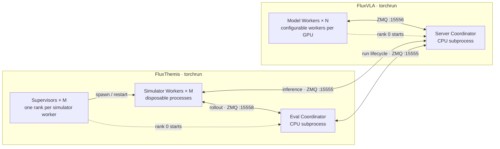

# FluxThemis

FluxThemis runs simulation and real-environment evaluation for FluxVLA. The
model boundary is a versioned ZMQ protocol: FluxThemis owns environments and
episode scheduling, while FluxVLA owns model loading, preprocessing, inference,
action denormalization, and authoritative benchmark artifacts.

## Responsibilities

| Component | Owns |
| --- | --- |
| FluxVLA | Model config, checkpoint, inference replicas, preprocessing, statistics, action units, authoritative evaluation journal and benchmark summary |
| FluxThemis | Evaluation config, simulator assets and layouts, environment processes, episode scheduling, action execution, videos, progress, resource monitoring and resume |

Every prediction request contains the complete observation and prompt. With
the default dynamic scheduling, consecutive requests from one episode may run
on different model workers. Fixed scheduling is also available when supported
and configured on both sides.

## Installation

For development, install only the core package and ZMQ runtime:

```bash
conda create -n fluxthemis-dev python=3.10 -y
conda activate fluxthemis-dev
cd /root/projects/FluxThemis
python -m pip install -e .
```

Evaluation workers run in simulator-specific environments. Choose one
benchmark environment; do not install all simulator stacks together.

For LIBERO:

```bash
cd /root/projects/FluxThemis
conda create -n fluxthemis-libero python=3.10 -y
bash scripts/install_libero.sh
```

For RoboCasa:

```bash
cd /root/projects/FluxThemis
conda create -n fluxthemis-robocasa python=3.10 -y
bash scripts/install_robocasa.sh
```

For RoboDojo:

```bash
cd /root/projects/FluxThemis
bash scripts/install_robodojo.sh
```

For RoboTwin 2.0:

```bash
conda create -n fluxthemis-robotwin python=3.10 -y
bash scripts/install_robotwin.sh
```

See [RoboTwin evaluation](docs/robotwin.md) for model and simulator startup,
task selection and compatibility notes.

Each simulator installer installs the FluxThemis package into its target
environment. A separate core environment is not required for evaluation.

FluxVLA and FluxThemis may use different Python environments. They only need a
reachable TCP endpoint and the same configuration semantics.

Activate the model or simulator environment before running its launcher.
Themis launchers use the active Python interpreter; `FLUXVLA_PYTHON` and
`FLUXTHEMIS_PYTHON` can select explicit interpreters for their respective sides.
Run the commands in prepared hosts or containers, with network access or an
SSH tunnel established by your deployment tools.

## Configuration

Model settings live in FluxVLA. Themis provides a simulator-only RoboDojo
configuration in [configs/robodojo/arx_x5.py](configs/robodojo/arx_x5.py).
The evaluation launcher accepts either a Python evaluation config or a launch
YAML such as [configs/robodojo/remote.yaml](configs/robodojo/remote.yaml) or
[configs/robotwin/remote.yaml](configs/robotwin/remote.yaml).
YAML holds paths, GPU/worker counts, connection settings and output locations;
`--smoke` and `--full` select the evaluation scope using the same config.

Existing FluxVLA configs remain usable: the evaluation launcher reads their
Themis evaluation settings without loading model weights. A combined config
can contain:

```python
themis = dict(
    transport=dict(
        image_keys=['cam_high', 'cam_left_wrist', 'cam_right_wrist'],
        state_keys=['states'],
        unnorm_key='robodojo_arx_x5',
    ),
    evaluation=dict(
        environment=dict(type='RoboDojoEnvironment', task_name='all'),
        policy_client=dict(type='FluxVLAPolicyClient'),
        reporter=dict(type='FluxVLAEvaluationReporter'),
        evaluator=dict(type='SuccessRateEvaluator'),
        base_seed=0,
        episodes_per_task=50,
        max_episode_steps=2000,
        execute_horizon=50,
    ),
    server=dict(
        evaluation_reporting=dict(enabled=True),
        denormalize_context=dict(task_suite_name='robodojo_arx_x5'),
    ),
)
```

`themis.transport` is injected into the policy client and reporter at runtime;
do not duplicate it inside either component mapping.

An `EvaluationRun` owns its validated `EvaluationSettings`, mutable lifecycle
state, evaluator, and reporter. The coordinator receives that run and only
schedules jobs across workers. Each torchrun rank supervises a disposable
worker process that owns the simulator environment, `PolicyClient`, and its
coordinator connection.

Every episode job carries `episode_index`, `policy_seed`, `environment_seed`,
and `environment_case_index` as separate values. Gymnasium and RoboCasa reset
from `environment_seed`; LIBERO selects an initial state and RoboDojo selects a
layout from `environment_case_index`. Rejected RoboDojo cases advance only the
case index, leaving both seeds and the episode identity unchanged.

The Python config defines transport fields and benchmark behavior, plus
model-side settings when used by FluxVLA. Supply deployment addresses and
simulator GPU/worker counts through launch YAML or command-line options.

## ZMQ Evaluation Launcher

Start the model and simulator independently in their prepared environments.
Use the same commands for two remote hosts or one host; choose GPU IDs for
each host's allocation and set a model endpoint reachable from the simulator.

On the model host, the existing FluxVLA command remains supported:

```bash
conda activate fluxvla
cd /root/projects/FluxVLA
CUDA_VISIBLE_DEVICES=0 \
bash scripts/distributed_zmq_server.sh \
  --config configs/pi05/pi05_paligemma_robodojo_full_finetune.py \
  --ckpt-path /shared/pi05/checkpoints/step-060000.safetensors
```

Keep your prepared model config, checkpoint, tokenizer and statistics paths.
For uniform GPU, worker-count and scheduling options, Themis also provides
[distributed_model.sh](scripts/distributed_model.sh), which delegates to
FluxVLA's existing model launcher; see the [launcher guide](guides/evaluation.md).

On the simulator host, run a one-episode RoboDojo smoke:

```bash
conda activate RoboDojo
cd /root/projects/FluxThemis
export ROBODOJO_ROOT=/root/projects/RoboDojo
bash scripts/run_evaluation.sh \
  --config configs/robodojo/arx_x5.py \
  --server-endpoint tcp://MODEL_HOST:15555 \
  --gpu-ids 0 --workers-per-gpu 1 --smoke \
  --output /shared/eval/robodojo
```

`MODEL_HOST` is the model host's reachable address, or `127.0.0.1` for a
same-host service or an existing local SSH forward. With an SSH tunnel, use
its forwarded ZMQ port, not the server's SSH login port. The two commands
above use GPU 0 on their respective hosts; adjust the IDs when sharing a host.

Replace `--smoke` with `--full` to run all tasks with the Python config's
per-task quotas. Smoke selects one task and one episode per simulator worker.
Add `--dry-run` to inspect the resolved plan without starting processes or
connecting to the model. The model service exits after an accepted `run_end`,
so start a fresh service when moving from smoke to a full evaluation.

To store launch settings in one file, edit the paths, model endpoint and GPU
settings in `configs/robodojo/remote.yaml`, then run:

```bash
bash scripts/run_evaluation.sh --config configs/robodojo/remote.yaml --smoke
```

LIBERO uses the same entry point with its matching evaluation config; see
[LIBERO evaluation](docs/libero.md). Other environments can use Python configs
with explicitly selected tasks and episode quotas.

Model workers and simulator workers are independent. Dynamic scheduling allows
four model workers to serve eight simulators; requests wait in the bounded
server queue when all model workers are busy. Fixed scheduling requires equal
worker counts and matching configuration on the model service.

The unified evaluation launcher defaults to one visible GPU and one worker
per GPU; use `--gpus`, `--gpu-ids` and `--workers-per-gpu` to override this.
The lower-level `distributed_model.sh` and `distributed_eval.sh` default to
the available GPU allocation, with one worker per GPU. They calculate the
process count as GPUs × workers per GPU; an explicit `NPROC_PER_NODE` must
match. FluxVLA's native `distributed_zmq_server.sh` requires both
`--workers-per-gpu` and a matching `NPROC_PER_NODE` for multiple workers per
GPU, using a FluxVLA version that supports replica-to-device mapping.

| Connection | Default port |
| --- | --- |
| Model frontend: prediction, status and reporting | 15555 |
| Model backend: model workers | 15556 |
| Simulator coordinator | 15558 |
| Simulator torchrun through `run_evaluation.sh` | 15559 |
| Simulator torchrun through `distributed_eval.sh` | 29501 |
| Model torchrun | 29500 |

The YAML field `simulator.coordinator_port` sets the coordinator port; the
unified launcher uses the next port for simulator torchrun. See the
[launcher guide](guides/evaluation.md) for detailed options and networking.

## Multi-Node Evaluation

`run_evaluation.sh` manages one simulator host, including multiple GPUs and
workers. For multiple simulator nodes, use `distributed_eval.sh` on each node
with its node/master settings.

Run one torchrun job for FluxVLA and another for FluxThemis. Each FluxThemis
rank supervises one disposable Simulator worker; rank 0 also starts the
evaluation Coordinator. The two jobs may use different node and GPU counts.
ZMQ carries evaluation data; no PyTorch process group is created.



Rank 0 remains a Supervisor and additionally starts its CPU Coordinator. A
Supervisor replaces only its own Simulator worker after a crash, startup or
episode timeout, or an unexpected exit with code 0. Normal completion requires
the Coordinator's shutdown instruction. The replacement reconnects with the
same logical worker identity, and the Coordinator requeues the same canonical
episode while other simulators continue. The model Worker count `N` is
independent of the simulator count `M`.

Start the model service as above. On each simulator node, for example:

```bash
conda activate RoboDojo
cd /root/projects/FluxThemis
bash scripts/distributed_eval.sh \
  --config configs/robodojo/arx_x5.py \
  --server-endpoint "tcp://$MODEL_HOST:15555" \
  --gpu-ids 0,1 --workers-per-gpu 2 \
  --run-name pi05-full \
  --video-dir /shared/eval/pi05-videos \
  --save-videos
```

The two tasks have separate `MASTER_ADDR`, `MASTER_PORT`, ranks, and failure
boundaries. Simulator nodes connect to the model frontend and their own
evaluation coordinator; the model frontend can use a reachable private
address or an established tunnel. The unified launcher waits for model
readiness and prints replica loading progress. During evaluation it shows one
updating line: `Episodes [progress bar] completed/total ETA HH:MM:SS`.
Redirected output records progress once per minute, with immediate updates on
status changes and completion. Counts include acknowledged completed episodes
from all simulator workers, including restored episodes. ETA uses only the
current run's execution speed and stays unknown until enough episodes finish.

The distributed shell launchers use `WORLD_SIZE` as node count, `RANK` as
node rank, and `MASTER_ADDR` / `MASTER_PORT` for their torchrun job.
On the MLP platform, they map `MLP_WORKER_NUM`,
`MLP_ROLE_INDEX`, `MLP_WORKER_0_HOST`, `MLP_WORKER_0_PORT`, and
`MLP_WORKER_GPU` to the same torchrun arguments.

## Artifacts

The unified launcher prints `Results: ...` and writes a run directory under
`--output` or YAML `run.output_root`. It contains the resolved plan and config,
`simulator.log`, acknowledged `events.jsonl`, `progress.json/log`, `result.json`,
resource samples and `performance_report.json/txt` with throughput and CPU/GPU
measurements. `progress.json` holds the latest count and ETA; detailed reports
are saved without being printed to the terminal. Video recording is enabled
with `--save-videos`.

To continue an interrupted run, add `--resume /path/to/previous-run` while
keeping its task and episode quotas. Resume validates the recorded config,
environment, assets and model identity, then reuses acknowledged completed
episodes. Model fingerprints must be supplied through `model.result_dir`
from the initial run; see [resume requirements](docs/robodojo.md#resume).

FluxVLA writes the authoritative event journal and benchmark summaries. By
default, they are placed beside the checkpoint under `eval_runs/`. An absolute
`themis.server.evaluation_reporting.result_output_dir` may point to any
persistent mounted directory.

FluxThemis simulator workers write videos to the evaluation-level `video_dir`.
Frame-rendering environments use the shared recorder, while environments with
native recording keep their simulator backend. The shared recorder writes
H.264/yuv420p MP4 files through ffmpeg. On cloud jobs, always use CPFS, OSS, or
another persistent mount for both result roots.

## Development

```bash
python -m pip install -e '.[dev]'
pytest -q
pre-commit run --all-files
```

See [LIBERO](docs/libero.md), [RoboCasa](docs/robocasa.md),
[RoboDojo](docs/robodojo.md), and [RoboTwin](docs/robotwin.md).
